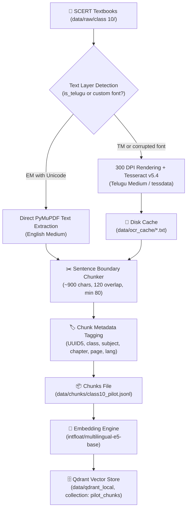

# Curriculum Ingestion Pipeline (Phase 1)

This folder contains the offline batch ingestion pipeline for BAALAVIDYA, converting Telangana SCERT textbooks into clean, metadata-tagged chunks, embeddings, and a searchable Qdrant index.

## Pipeline Architecture



## Directory Structure

```
ingestion/
├── data/
│   ├── raw/class 10/       # Raw SCERT PDFs (supplied & verified under R6)
│   ├── ocr_cache/          # Cached OCR extractions per page
│   ├── chunks/             # Chunks in JSONL format (class10_pilot.jsonl)
│   ├── qdrant_local/       # Local persistent Qdrant vector database
│   └── eval/               # Evaluation outputs (r1_bilingual.md)
├── tessdata/               # Tesseract language models (tel.traineddata, eng.traineddata)
├── tests/                  # Phase 1 test suite (test_phase1.py)
├── pipeline.py             # Main end-to-end extraction and chunking pipeline
├── ocr.py                  # PyMuPDF rendering and Tesseract OCR engine
├── ocr_pilot_telugu.py     # Batch OCR script for pilot Telugu chapters
├── ocr_eval.py             # R7 Telugu OCR quality evaluator
└── embed_eval.py           # R1 embedding model evaluation and Qdrant indexer
```

## How to Run

From the repository root using the ingestion virtual environment:

### 1. Extract and Chunk All Pilot Textbooks
```bash
ingestion\.venv\Scripts\python.exe ingestion\pipeline.py
```
Outputs `1,862` chunks (1,687 English, 175 Telugu) to `ingestion/data/chunks/class10_pilot.jsonl`.

### 2. Embed and Index into Qdrant
```bash
ingestion\.venv\Scripts\python.exe ingestion\embed_eval.py
```
Indexes all 1,822 valid chapter chunks into Qdrant local collection `pilot_chunks` using `intfloat/multilingual-e5-base` (dim: 768).

### 3. Run Phase 1 Verification Tests
```bash
ingestion\.venv\Scripts\pytest.exe ingestion\tests\test_phase1.py -v
```

## Key Decisions & Evaluation Reports

- **ADR 0001 (Embedding Model):** `intfloat/multilingual-e5-base` accepted based on evidence in `docs/eval-results/r1_bilingual.md` (93.8% Telugu Recall@5, 100% on curated core queries, 3.4x faster encoding than `bge-m3`).
- **ADR 0007 (Vector Store):** `qdrant-client` local embedded mode accepted for Phase 1.
- **ADR 0008 (OCR Engine):** Tesseract OCR accepted based on evidence in `docs/eval-results/r7_ocr_quality.md` (83.2% Telugu density, zero page failures).
